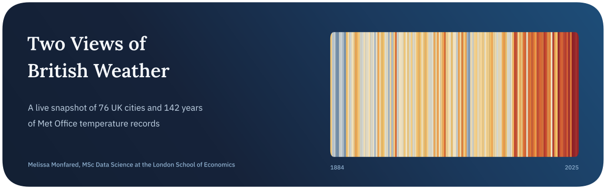
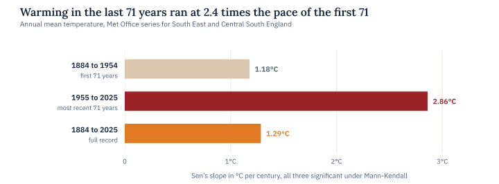
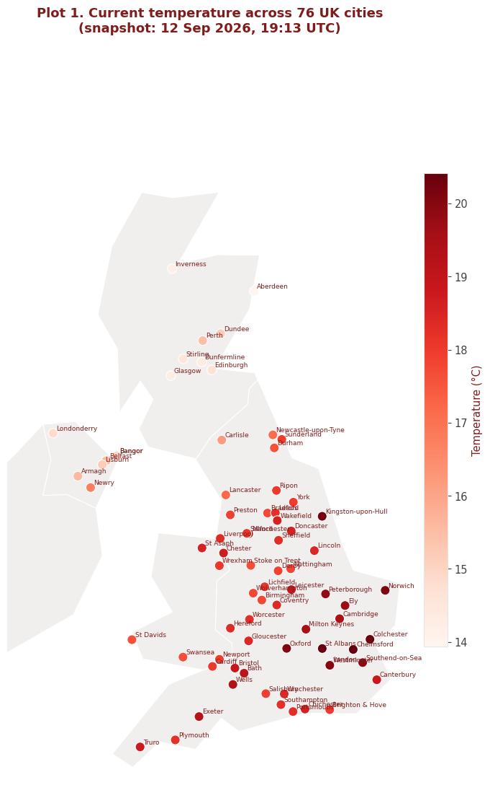
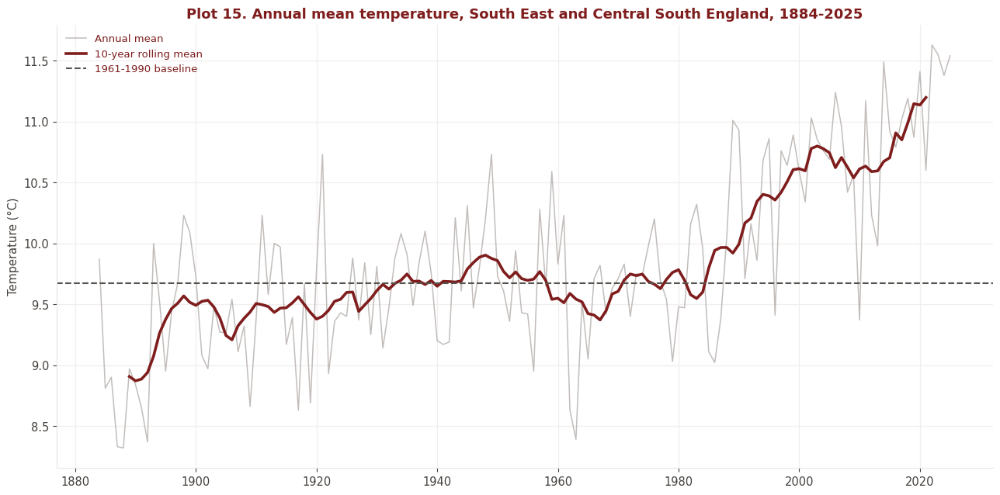
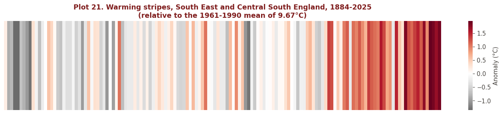
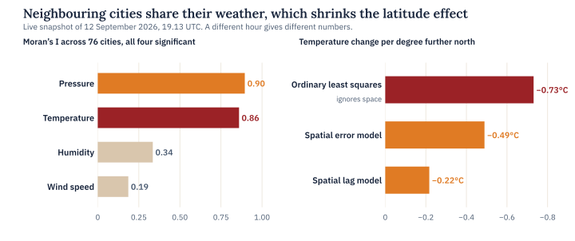
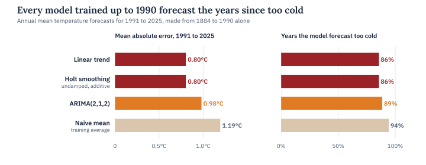

<p align="center">
  
</p>

<p align="center">
  
  
  
  
</p>

Weather and climate are two different statistical objects that happen to share a name. Weather is a cross-section, many places at one moment, so its questions are spatial. Climate is a time series, one place over many years, so its questions are about trend. This project treats each one with the tools it actually needs.

The first half builds a live snapshot of every city in the United Kingdom, 76 of them, scraped from the government’s official list and matched to current readings from the OpenWeatherMap API. The second half takes the Met Office’s official temperature series for South East and Central South England, an unbroken record from 1884, and asks whether the warming in it is real and whether it is speeding up.

> **In short.** On the evening it was measured, UK weather was strongly clustered in space, with temperature falling about 0.7°C for every degree further north. Over 142 years, South East England warmed by about 1.3°C per century, and the most recent 71 years warmed 2.4 times faster than the first 71. Every forecasting model trained on data up to 1990 then predicted the following decades too cold.

## Key findings

| Finding | Evidence |
| :-- | :-- |
| Nearby cities share their weather | Moran’s I for temperature was 0.86 (z = 13.4, permutation p = 0.001), and 0.90 for pressure, against roughly zero under spatial randomness |
| Latitude cools, but space explains much of it | Temperature fell 0.73°C per degree north in the ordinary regression (R² = 0.64). Once neighbouring cities were allowed to explain each other in a spatial lag model, the effect shrank to 0.22°C |
| The coast pointed the unexpected way | Cities further inland were slightly warmer, by 0.007°C per kilometre (p = 0.005), the opposite of the simple maritime story, which one evening’s snapshot can’t settle |
| South East England is warming, and faster | Sen’s slope is 1.29°C per century over 1884 to 2025 (Mann-Kendall p ≈ 2 × 10⁻¹⁶), rising from 1.18 in the first 71 years to 2.86 in the last 71 |
| The last decade sits far above the old normal | 2016 to 2025 averaged 1.53°C above the 1961 to 1990 baseline, and 2022 was the warmest year on record at +1.96°C |
| The past forecast the present too cold | Models trained on 1884 to 1990 underpredicted between 86% and 94% of the years since, and the best of them still missed by 0.80°C on average |

<picture>
  <source media="(prefers-color-scheme: dark)" srcset="assets/trend-dark.svg">
  
</picture>

## Conclusion

The two halves answer different questions, and both turned out to have clear answers. In space, the country’s temperature on the evening of the snapshot was a smooth, strongly clustered field, with latitude doing most of the work a simple model can see. In time, South East England has warmed by about 1.3°C per century since 1884, and that pace more than doubled in the most recent 71 years.

The forecasting test is the most direct evidence that the warming is speeding up. Models fitted only to 1884 to 1990 had no way to anticipate an acceleration, and every one of them forecast most of the following 35 years too cold. The simplest trend models did best, partly because Holt’s smoothing parameters were fitted at zero, which turns it into the same straight line as the linear trend.

Several results are deliberately modest about what they show. The spatial findings describe a single evening, and the weather regimes found by clustering were weak, with a silhouette of only 0.34. Comparing that evening with 142 years of Septembers looks dramatic at 4.4 standard deviations, but once single days and monthly averages are put on the same footing it shrinks to between 1.6 and 2.0, a warm evening rather than an extreme one.

## The data

**The live snapshot.** A scraper reads the official list of UK cities from GOV.UK, 76 in total, 55 in England, 8 in Scotland, 7 in Wales and 6 in Northern Ireland, and the OpenWeatherMap API returns current conditions for each one. The run saved in this notebook fetched all 76 on 12 September 2026 at 19.13 UTC. Because the data is live, a fresh run gives different numbers for this half, though the notebook tracks which patterns have held across repeated runs.

<p align="center">
  
</p>

**The climate record.** The second dataset is the Met Office’s areal mean temperature series for South East and Central South England, part of the HadUK-Grid product, read straight from the Met Office website. It gives 142 complete years from 1884 to 2025. The file is parsed as fixed-width text, so the half-finished current year keeps its values in the right columns.





*Annual mean temperature with its ten-year rolling mean, and the same record as warming stripes against the 1961 to 1990 average of 9.67°C.*

## Methods

| Question | Method | Result in the saved run |
| :-- | :-- | :-- |
| Is the weather spatially clustered? | Moran’s I on five nearest neighbours, rechecked from 3 to 15 neighbours | 0.86 for temperature, and between 0.69 and 0.87 for every neighbourhood size tried, all with p = 0.001 |
| What predicts temperature? | Ordinary least squares with HC1 standard errors, then spatial lag and spatial error models | Latitude at −0.73°C per degree in OLS and between −0.22 and −0.49 in the spatial models. The OLS residuals were still clustered (Moran’s I = 0.62) |
| Are there weather regimes? | K-means chosen by silhouette, checked against Ward clustering and DBSCAN | Two groups of 50 and 26 cities with a silhouette of 0.34, and DBSCAN labelled 65 of the 76 cities as noise |
| Is the series stationary? | Augmented Dickey-Fuller test | The unit root isn’t rejected (p = 0.80), as a trending series should behave |
| Is there a real trend? | Mann-Kendall test and Sen’s slope, on the full record and on each half | 1.29°C per century overall, accelerating from 1.18 to 2.86 |
| Did the climate shift? | Welch’s t-test on the years before and after 1970 | A difference of 0.90°C (t = 7.9) |
| Can the past forecast the present? | Naive mean, linear trend, Holt smoothing and ARIMA(2,1,2), trained on 1884 to 1990 and tested on 1991 to 2025 | Mean absolute error of 0.80°C for the linear trend and Holt, 0.98°C for ARIMA and 1.19°C for the naive mean |

<picture>
  <source media="(prefers-color-scheme: dark)" srcset="assets/spatial-dark.svg">
  
</picture>

<picture>
  <source media="(prefers-color-scheme: dark)" srcset="assets/forecast-dark.svg">
  
</picture>

## Limitations and next steps

The cross-section is one evening, so it can’t tell a lasting geographic pattern from the position of that day’s weather systems. The temperature record covers one region of England, which is enough to establish its warming but not to claim the same rate for the whole UK. The distance-to-coast measure comes from a coarse coastline file and ignores which way the coast faces, and the ARIMA order was chosen by judgement rather than by a formal search.

The natural next step is a panel, the same cities over many years. The Met Office publishes its other regional series in the same format, so repeating the trend analysis for Scotland, Wales, Northern Ireland and the rest of England would show whether the pace of warming itself varies by region.

## Running it

Both datasets are fetched live, so the notebook needs internet access and a free OpenWeatherMap API key, entered in the API_KEY line of the data-acquisition cell. Everything else, from the city list to the coastline file, downloads on the fly.

```bash
pip install requests beautifulsoup4 pandas numpy scipy matplotlib seaborn geopandas shapely libpysal esda spreg statsmodels pymannkendall scikit-learn
jupyter notebook british-weather-a-spatial-and-temporal-analysis-.ipynb
```

## Repository

```text
.
├── british-weather-a-spatial-and-temporal-analysis-.ipynb   both datasets, the spatial models, the trend tests and the forecasts
├── assets/                                                  figures used in this README
└── README.md
```

## About

Made by Melissa Monfared, MSc Data Science at the London School of Economics. More projects live on [my website](https://melissamonfared.github.io). I also post notebooks on [Kaggle](https://kaggle.com/melissamonfared) and I’m on [LinkedIn](https://linkedin.com/in/melissamonfared).

City list from GOV.UK, live weather from OpenWeatherMap and the temperature record from the Met Office’s HadUK-Grid regional series.
